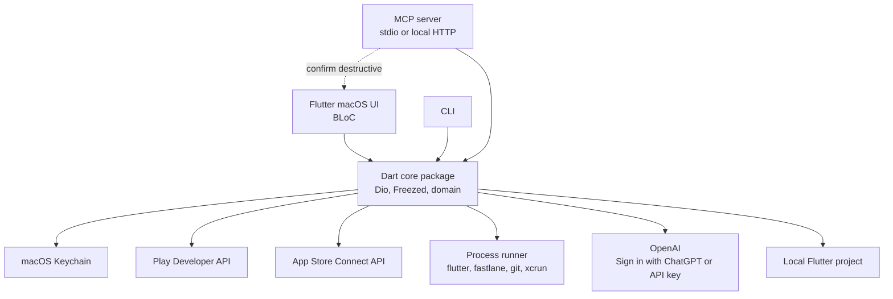

# Release Copilot MVP Spec

High-level product and technical spec for a local-first macOS Flutter app that takes a Flutter project from live store versions to the next build, upload, notes, and status, including AI release notes and an MCP server in the first cut.

- [Overview, goals, and non-goals](#overview)
- [Decisions](#decisions)
- [Target user and pricing](#user-pricing)
- [User stories](#stories)
- [Feature specs](#features)
  - [Flavors and version sources](#feature-flavors)
  - [Version dashboard](#feature-dashboard)
  - [Next build number](#feature-bump)
  - [Local build and upload](#feature-build)
  - [Status alerts](#feature-alerts)
  - [AI release notes from git](#feature-notes)
- [Architecture](#architecture)
  - [Signing the macOS app](#signing)
- [Data model](#data-model)
- [API integration](#apis)
- [Security](#security)
- [MCP server](#mcp)
- [Milestones](#milestones)
- [Risks and remaining questions](#risks)
- [Later roadmap](#roadmap)
- [Sources](#sources)

## Overview, goals, and non-goals

Release Copilot is a macOS desktop app, built in Flutter for the macOS target, that helps indie and mobile developers ship Flutter apps to Google Play and to TestFlight and the App Store. The first customer is Vitalii Zeienko, who will dogfood it on his own apps and then decide how to evolve it. The daily pain the MVP removes is knowing what is live, choosing a safe next build number, writing notes, uploading, and hearing when processing or review finishes.

> **Dogfood first**
>
> The price goal is about $5 a month for a packed tool later. The MVP is a personal local tool with no billing, no accounts, and no cloud of its own. AI release notes from git and a local MCP server are in this first cut, not a later phase.

### Goals

- Show, in one window, the latest version and build on every Play track and on TestFlight and the App Store, per flavor.
- Compute a shared next build number per flavor, write it with that flavor's marketing version, and optionally commit and tag as `v1.2.3`.
- Run a local `flutter build` and upload the artifact, with the log in the UI.
- Notify on TestFlight processing, Play review or rollout changes, and rejections.
- Draft store-ready release notes from `git log` since the last release tag, with the user's OpenAI account, then let the user edit and push them.
- Expose the same actions over a local MCP server so Cursor or Claude Code can drive a release, with destructive steps confirmed in the app.

### Non-goals for the MVP

- Billing, subscriptions, or a $5 paywall.
- Team accounts, cloud sync, or hosted CI. This is not a Codemagic, Bitrise, or Runway replacement.
- Windows or Linux, and distribution through the Mac App Store (the sandbox would block local builds).
- Screenshot, preview, and listing metadata management.
- Slack, email, or other team chat integrations. macOS notifications are enough.
- Sending the LLM source diffs, files, or credentials. Commit messages and tag metadata only.
- Silent production rollouts or App Review submissions. Those stay explicit and confirmed.
- Melos or other multi-package workspaces, per-product git tags, and per-platform build-number drift warnings. Those come after the MVP.

## Decisions

These close the open questions from the first draft, as answered on 25 Nov 2026, Europe/Rome.

| Topic | Decision |
| --- | --- |
| Build numbers | One shared integer per flavor, taken as the max of that flavor's Play version codes, integer Apple builds, and local build, then plus one. Per-platform or per-flavor drift detection with a warning is a follow-up, not in the MVP. |
| Git tags | The dogfood repo is empty, so tags are plain semver with a v prefix: `v1.2.3`. Per-product tags such as `productA/v1.2.3` are a later option for multi-product repos. |
| Signing this macOS app | A paid Apple Developer Program membership is not required to build and run Release Copilot on the author's Mac. It is required to sign with Developer ID, notarize, and distribute outside the Mac App Store, and to ship on the Mac App Store. Store features still need the author's existing App Store Connect API key. See Signing the macOS app. |
| Week 4 upload scope | Week 4 uploads to Play tracks and TestFlight. Production Play rollouts and App Review submissions stay separate, confirmed actions. |
| LLM | OpenAI only in the MVP. Prefer Sign in with ChatGPT so the user spends their own ChatGPT plan tokens. Fallback: paste an OpenAI API key into the Keychain. |
| Project shape | The MVP supports one git repo that contains one Flutter app with multiple flavors, not only a single flavorless `pubspec.yaml`. Melos and multi-package workspaces come later. |

## Target user and pricing

The primary user is a solo or small-team Flutter developer who already has Play Console and App Store Connect access, ships from a Mac, and lives in a local toolchain (Flutter, Xcode, and often Fastlane or Very Good CLI). Vitalii is the design partner: eight years as a senior Flutter developer, Cursor and Claude in the loop, Very Good CLI as the usual project shape. His own apps use several flavors in one repo (ProductA, ProductB, and matching Dev flavors), which is why flavors are in the MVP.

Existing options leave a gap the $5 goal is meant to fill later. Thimble is free and covers both stores, but does not bump, build, or write notes. Helm ($9.99/month) and Asomium (€14.99/month) are Apple only. Cloud CI is built for teams and pipelines, not a local daily release desk.

| Product | Stores | Price | Gap versus this MVP |
| --- | --- | --- | --- |
| Thimble | Play and Apple | Free | No bump, local build, notes, or MCP |
| Helm | Apple only | $9.99/month | No Play, and above the $5 goal |
| Asomium | Apple only | €14.99/month | No Play, and above the $5 goal |
| Codemagic, Bitrise, Runway | Both, in CI | Team or cloud pricing | Hosted pipelines, not a local dogfood tool |

## User stories

Each story is written from Vitalii's desk on a release day. The MCP variants are the same jobs, started from Cursor or Claude Code.

1. **See what is live before I bump**

   I pick a flavor and see version and build on every Play track, plus the latest TestFlight build and App Store version, without opening two consoles.

2. **Take the next safe build number**

   The app proposes a shared max(store builds for this flavor, local build) + 1, writes the flavor's marketing version plus that build, and can commit and tag `v1.2.3` if I opt in.

3. **Draft notes from git, then edit**

   I get Play and TestFlight or App Store notes from conventional commits since the last `v1.2.3` tag, already clipped to store limits, using my ChatGPT plan or OpenAI API key, and I edit them before anything is pushed.

4. **Build and upload on this machine**

   I run `flutter build appbundle` and/or `flutter build ipa` for the chosen flavor and scheme, then upload, and watch a streaming log until the store accepts the file.

5. **Hear when waiting is over**

   A macOS notification tells me when TestFlight processing finishes, when a Play review or rollout changes, or when a submission is rejected.

6. **Drive the same loop from the agent**

   Cursor or Claude Code can read versions, propose a bump, generate notes, and start a build over MCP, but any write, upload, or push waits for a confirmation in the app.

## Feature specs

Acceptance criteria below are the MVP bar. A project is a git repo that contains a Flutter app (a Very Good layout is fine). The user points the app at that repo. Several repos may be linked; the dashboard is per app and, inside an app, per flavor.

### Flavors and version sources

The old open question was how much of a multi-package Flutter workspace the first version should understand, versus only pointing at one `pubspec.yaml`. In plain language: can the MVP handle an app that ships several flavors (different bundle IDs, package names, and Xcode schemes in one repo), or only a single-app folder with one identity?

The default is the first of those. The MVP supports one git repo that contains one Flutter app with multiple flavors, because that is Vitalii's own case (ProductA, ProductB, DevProductA, DevProductB). Each flavor maps to a store identity and a version source. Melos or other multi-package workspaces come later.

- A flavor record includes a name, Play package name, iOS bundle ID, Xcode scheme, and a marketing-version source.
- Marketing versions can differ per product. The supported source in the MVP is a custom `flavor_versions:` section in `pubspec.yaml`, read by a small script or by the core package and passed to Flutter as `--build-name`. The shared build number is passed as `--build-number`.
- The shared build number is computed per flavor, across that flavor's Play and iOS listings only. ProductA and ProductB do not share a counter.
- Dev flavors can point at internal or TestFlight destinations and still use the same rules.
- Builds use the mapped Xcode scheme and Flutter flavor flags. If a scheme or flavor is missing, the UI says so before a build starts.

### Version dashboard

One screen per linked app, filtered by flavor, lists the latest marketing version and build on each Play track returned by the API (standard tracks are `internal`, `alpha`, `beta`, and `production`; custom and form-factor tracks such as `wear:production` are included when present) and the latest TestFlight and App Store versions. Stale or failed fetches are visible, with a manual refresh.

- Play data comes from the Google Play Developer API. Discover tracks with an edit (`edits.insert`, then `GET .../applications/{packageName}/edits/{editId}/tracks`, then discard or let the unused edit expire). For recent release and review-shaped status, also call `GET .../applications/{packageName}/tracks/{track}/releases`, which returns at most 20 non-obsolete releases.
- Apple data comes from the App Store Connect API: `GET /v1/apps/{id}/preReleaseVersions`, `GET /v1/builds` filtered by app, and `GET /v1/apps/{id}/appStoreVersions`. Surface `processingState` on builds and the version state fields Apple returns (`appVersionState` and, where still present, `appStoreState`).
- Each row shows store, track or channel, version, build, status, and time last checked.
- Credentials are entered once per account (Play service-account JSON; ASC .p8, key ID, and issuer ID) and stored in the macOS Keychain. A connection test runs before the dashboard is considered set up.

### Next build number

Flutter versioning is `x.y.z+N`, where `x.y.z` is the marketing version (`versionName` / `CFBundleShortVersionString`) and `N` is the build (`versionCode` / `CFBundleVersion`) when using the usual Flutter mapping. For flavored apps the MVP writes the flavor's marketing version and the shared build through `--build-name` and `--build-number` rather than a single global `version:` line only.

- For the selected flavor, the proposed build is the maximum of: every integer Play `versionCodes` value on that flavor's discovered tracks, the local build number for that flavor, and every TestFlight or App Store build string for that flavor that parses as an integer; then add one.
- Build strings that are not plain integers are excluded, and the UI warns so the user can set `N` by hand. Detecting Play versus iOS drift, or flavor-counter drift, is explicitly out of the MVP.
- Marketing version changes are optional and explicit, and come from that flavor's version source.
- Optional git commit and tag are off by default. When tagging, the default is `v1.2.3` (marketing version only, with a v prefix). Per-product tags such as `productA/v1.2.3` are postponed.
- The write is previewed and confirmed before the file or git state changes, including when the request comes from MCP.

### Local build and upload

Builds run on the user's machine, not in a cloud CI. The app spawns the Flutter toolchain and then uploads with Fastlane (`supply` for Play, `pilot` for TestFlight) or a direct path (Play bundles upload inside an edit, then `tracks.update` and `edits.commit`; Apple via `xcrun altool` or Transporter, or the App Store Connect upload APIs). Fastlane is the default when it is installed; otherwise the direct path is used.

- Android: `flutter build appbundle`. iOS: `flutter build ipa`. The user picks a flavor, one or both platforms, and a destination track or TestFlight. Flavor flags, `--build-name`, `--build-number`, and the Xcode scheme are applied.
- The UI streams combined stdout and stderr, including the exit code, and never hides a signing or provisioning error.
- Upload of a production Play release or an App Store version submitted for review is a separate, confirmed step, not an automatic side effect of a TestFlight or internal-track upload.
- Signing, certificates, provisioning profiles, and Play App Signing for the mobile apps stay in the existing local and console setup. The MVP does not provision certificates for those apps.

### Status alerts

- While a build is in flight, poll TestFlight `processingState` until it reaches a terminal value (for example `VALID`, `FAILED`, or `INVALID`) and notify on success or failure.
- Poll Play release status (`draft`, `inProgress`, `halted`, `completed`, plus review-related states from `applications.tracks.releases`) and notify on review outcome, staged-rollout changes (`userFraction`), halt, or rejection.
- Use macOS notifications. Clicking a notification focuses the matching project and flavor in the app.
- Honor App Store Connect `X-Rate-Limit` headers and HTTP 429. Limits are per API key on a rolling hour and can vary; Apple's docs illustrate `user-hour-lim:3500` but that figure is not a guaranteed quota. Poll slowly (tens of seconds while processing, much slower when idle). Play Publishing APIs default to 3,000 queries per minute, which is ample for a personal client.

### AI release notes from git

Notes are generated from `git log` since the last release tag (or a tag or commit the user picks). The default tag pattern is `v1.2.3`. The parser understands Conventional Commits (`feat`, `fix`, `BREAKING CHANGE`, and the usual types), groups user-facing changes, and can drop `chore`, `ci`, `test`, and `docs` by default.

- The only MVP provider is OpenAI. The preferred path is Sign in with ChatGPT (OAuth), so eligible Plus or Pro users spend tokens from their ChatGPT plan on the Responses API. The fallback is a pasted OpenAI API key, stored in the Keychain and billed at standard API rates.
- The prompt receives commit subjects and bodies, tag names, and dates only. OAuth tokens and API keys never go to the model.
- The app produces at least one Play note and one Apple note (TestFlight What to Test, and App Store What's New when a version localization is in play). The user can add locales the project already uses on each store.
- Play release notes are capped at 500 Unicode characters per language, per Google Play Console Help, Prepare and roll out a release. App Store What's New is capped at 4,000 characters, per App Store Connect Help, Platform version information.
- TestFlight What to Test is the `whatsNew` attribute on `betaBuildLocalizations`. Third-party tooling commonly treats that field as 4,000 characters per locale; Apple's public Help pages checked for this spec do not state the number, so the editor should treat 4,000 as a working limit and trust API validation if it differs.
- The editor shows a live character count per locale and blocks a push that is over the verified Play or App Store limit.
- Nothing is pushed until the user accepts the draft. Play notes go on the release as `LocalizedText` (`language`, `text`). Apple TestFlight notes go to `betaBuildLocalizations`; App Store What's New goes to `appStoreVersionLocalizations.whatsNew`.

## Architecture

One Dart core package owns domain logic, store clients, git and version writes, process running, and note generation. The Flutter macOS UI, a small CLI, and the MCP server are three fronts over that package. The UI uses BLoC, Dio, and Freezed, matching Vitalii's usual Very Good stack. A Very Good workspace with `packages/release_copilot_core`, `apps/release_copilot`, `packages/release_copilot_cli`, and `packages/release_copilot_mcp` is the intended layout for this tool's own code. Melos support for the user's multi-package apps is not in the MVP.

The process runner must stream output, support cancel, and record the working directory and command without recording secret flags.

### Signing the macOS app

This section is about signing Release Copilot itself, not the iOS or Android apps it uploads. A paid Apple Developer Program membership is not required to build and run the tool on the author's Mac. Apple's Xcode documentation says you do not need to set up signing to run a macOS app on your Mac unless you add capabilities that require provisioning. If you are not in the program, Xcode still creates a personal team when you add an Apple Account. Ad-hoc signing, shown in Xcode as Sign to Run Locally, is enough for local debug and dogfood (`flutter run -d macos` or a local release build you launch yourself).

A paid membership is required to distribute. Developer ID certificates are issued only to program members (Account Holder), and Apple's security guide says that on macOS 10.15 or later, apps distributed outside the Mac App Store need a Developer ID signature and notarization to run under default Gatekeeper settings. Notarization also requires the Hardened Runtime. Mac App Store distribution likewise requires program membership, and App Sandbox is required for the Mac App Store. Flutter's own macOS guide notes the same split: App Store or a notarized `.app` outside it, with a valid signing certificate once Hardened Runtime is on. The MVP ships as a local dogfood build. When the tool is later shared with other people, distribute it outside the Mac App Store with Developer ID signing and notarization, and with the App Sandbox off, so it can spawn `flutter`, Fastlane, `git`, and `xcrun`, and read a user-chosen project folder.

Flutter macOS projects enable App Sandbox by default in `macos/Runner/*.entitlements`. That default must be turned off for Release Copilot. Network and file entitlements that only exist to punch through a sandbox are not a substitute for leaving the sandbox off. Keychain Sharing (`keychain-access-groups`) is a restricted capability whose availability depends on membership and certificate type; a Developer ID build should not depend on it. Store secrets in the app's own default access group (team ID plus bundle ID) or the file-based login keychain, and avoid data-protection keychain APIs that require that entitlement. Configure `flutter_secure_storage` that way, or use a small native Keychain wrapper.

Separately, the author already needs an Apple Developer Program membership and an App Store Connect API key to talk to TestFlight and the App Store on behalf of the mobile apps. That key does not sign the Copilot binary, but without it the Apple half of the dashboard cannot work. A free personal team also cannot notarize Mac software or use App Store Connect.

Claude can help run a native macOS app during development, but that is a different product surface from how Release Copilot is signed or shipped. Claude Code computer use, a research preview on macOS for Pro, Max, or Ultra plans signed in through claude.ai, can compile a native app, launch it, click through the UI, and take screenshots from the same session that wrote the code. That is the closest match to running a Flutter macOS desktop app built with Claude. A separate Claude Desktop beta, Install as app, announced 24 Nov 2026, turns Claude artifacts into Mac or Windows apps with their own icon and window, without the author packaging or signing them. Those apps require being online and signed in to Claude, and they are not a replacement for a Developer ID-signed Flutter app. Neither feature changes Apple's signing or Gatekeeper rules.

## Data model

Project metadata can live in local app support storage (SQLite or a similar store). Secret material is referenced by a Keychain id and is never persisted in the metadata file, logs, or crash reports.

| Entity | What it holds |
| --- | --- |
| Project | Display name, path to the Flutter repo, default tag pattern (`v1.2.3`), preferred upload path (Fastlane or direct), and a list of flavors. |
| Flavor | Name, Play package name, iOS bundle ID, ASC app id, Xcode scheme, Flutter flavor flag, marketing-version source (`flavor_versions:` or equivalent), default locales, default destination tracks. |
| StoreCredential | Provider (Play, ASC, or OpenAI), a non-secret hint (key id, service-account email, ChatGPT account, or key suffix), and a Keychain reference. No raw JSON, .p8, OAuth refresh token, or API key in this record. |
| TrackStatus | Flavor, store, track or channel, marketing version, build, status, optional `userFraction`, last checked time, last error. |
| Release | Project, flavor, marketing version, build, git range, notes by store and locale, and state (draft, uploaded, processing, live, rejected). |

## API integration

### Google Play Developer API

**Auth:** Service-account JSON, OAuth 2.0 server-to-server (Google JWT assertion is RS256, not ES256). Access token as `Authorization: Bearer`. Scope `https://www.googleapis.com/auth/androidpublisher`. Invite the service account in Play Console Users and permissions with rights to view and manage releases. Enable the Google Play Developer API on the Cloud project.

**Read tracks:** `POST /androidpublisher/v3/applications/{packageName}/edits`, then `GET /androidpublisher/v3/applications/{packageName}/edits/{editId}/tracks`. Optional: `GET /androidpublisher/v3/applications/{packageName}/tracks/{track}/releases` for up to 20 recent non-obsolete releases, including review-shaped states.

**Upload:** Upload a bundle in an edit, attach it with `edits.tracks.update` (`versionCodes`, `status`, optional `releaseNotes` and `userFraction`), then `edits.commit`. Release `status` values are `draft`, `inProgress`, `halted`, and `completed`.

**Notes:** `releaseNotes[]` as `LocalizedText`: BCP-47 `language` plus `text`. 500 Unicode characters per language.

**Quota:** Publishing APIs share a bucket with a default of 3,000 queries per minute, independent of billing buckets. See https://developers.google.com/android-publisher/quotas

### App Store Connect API

**Auth:** JWT signed ES256 with the .p8 private key. Header: `alg=ES256`, `kid`, `typ=JWT`. Team-key payload: `iss` (issuer ID), `iat`, `exp`, `aud=appstoreconnect-v1`, optional `scope`. Individual keys use `sub=user` and omit `iss`. Tokens that expire more than 20 minutes ahead are rejected for ordinary requests. Reuse a token until it expires. Send `Authorization: Bearer`.

**Read versions:** Base `https://api.appstoreconnect.apple.com`. `GET /v1/apps/{id}/preReleaseVersions`, `GET /v1/builds` with `filter[app]`, `GET /v1/apps/{id}/appStoreVersions`. Build fields include `version`, `processingState`, and `preReleaseVersion`.

**Notes:** TestFlight: create or patch `betaBuildLocalizations` (`locale`, `whatsNew`). App Store: patch `appStoreVersionLocalizations` (`whatsNew`). What's New is limited to 4,000 characters.

**Rate limits:** Per API key, rolling hour, advertised on every response as `X-Rate-Limit: user-hour-lim:...;user-hour-rem:...`. Over the limit, HTTP 429 with `RATE_LIMIT_EXCEEDED`. Actual limits can vary. Docs: https://developer.apple.com/documentation/appstoreconnectapi/identifying-rate-limits

### OpenAI, Sign in with ChatGPT

OpenAI's Sign in with ChatGPT lets a user sign in with a ChatGPT account and, when eligible, authorize the app to make Responses API requests billed against their ChatGPT plan rather than an API key. OpenAI documents this for open-source and locally hosted apps. Eligible users are ChatGPT Plus and Pro. The flow is OpenID Connect with PKCE, dynamic client registration, a stable `ext_agent_host_id`, and a loopback redirect. The access token is sent as `Authorization: Bearer` to `https://api.openai.com/v1/responses`. It does not grant access to the user's ChatGPT conversations or to their API key. This is the same family of sign-in Codex CLI uses (`codex login`), as opposed to `codex login --with-api-key`.

Availability is narrower for commercial products. Sign in with ChatGPT for identity on websites is a limited trial for selected commercial partners. ChatGPT plan usage is documented as available to open-source projects, personal projects that run locally, and selected private apps. For a paid or remotely hosted app, OpenAI asks developers to join a waitlist or complete an interest form before offering plan usage to users. That matters later if Release Copilot becomes a $5-a-month product; it does not block dogfood as a local personal tool. The MVP always offers the fallback of pasting an OpenAI API key into the Keychain, which is billed at standard API rates on the user's OpenAI Platform account.

## Security

- Play JSON, ASC .p8 material, OpenAI API keys, and Sign in with ChatGPT tokens never leave the machine. They are not sent to any Release Copilot server (there is none in the MVP), not written to disk outside Keychain, and not included in logs, crash reports, MCP responses, or LLM prompts.
- The LLM sees only commit subjects and bodies plus tag names and dates. If a commit message looks like a secret (key, token, password), the app warns and can strip that commit before the prompt is sent.
- The optional MCP HTTP transport binds to 127.0.0.1 only. stdio is the default for Cursor and Claude Code.
- Destructive MCP tools do not run until the macOS app shows a confirmation the user accepts. A timeout or dismissal cancels the tool call.
- No analytics of project paths, package names, or store identifiers in the MVP.

## MCP server

The server is a local process over the same Dart core package. stdio is the default so Cursor and Claude Code can attach it as an MCP server. Optional HTTP is loopback only. Tools return structured data, not secret material. `generate_release_notes` returns a draft; pushing notes to a store is an explicit `apply` flag on that tool, or a follow-up confirmation in the app, never an implicit side effect. Tools that act on a project also take a `flavor` when the repo has more than one.

| Tool | Inputs | Outputs | Confirm |
| --- | --- | --- | --- |
| `get_versions` | `project_id`, optional `flavor` | Per-track and per-channel version, build, status, last checked | No |
| `next_build_number` | `project_id`, `flavor` | Proposed marketing version and shared `N`, the max values used, and any skipped non-integer builds | No |
| `bump_version` | `project_id`, `flavor`, optional marketing version, optional build, `commit`, `tag` | New version written for that flavor and any `v1.2.3` commit or tag created | Yes |
| `build_and_upload` | `project_id`, `flavor`, platforms, destination track or TestFlight, optional notes id | Build result, upload result, log tail reference | Yes |
| `get_release_status` | `project_id`, optional `flavor`, optional release id | Processing, review, and rollout state for in-flight and latest releases | No |
| `generate_release_notes` | `project_id`, optional `flavor`, optional since-tag, locales, stores, optional `apply` | Draft notes per store and locale, character counts, limits. Apply pushes only after confirmation | Apply only |

## Milestones

About six to eight weeks for one experienced Flutter developer (Vitalii, or an agent he directs), given that notes and MCP are in the MVP. Dates are not fixed; each week has an exit bar.

| Week | Focus | Exit bar |
| --- | --- | --- |
| 1 | Workspace, core package, Keychain credentials, link a local flavored project | A Play JSON and an ASC key can be stored and retrieved; a repo path and at least two flavor records (package name, bundle ID, scheme, version source) are saved. The Copilot macOS app itself runs locally with ad-hoc or development signing; no Developer ID or notarization is required for this week |
| 2 | Play and ASC clients, read-only dashboard per flavor | One real flavored app shows live track and TestFlight or App Store versions after a connection test |
| 3 | Shared next build number, flavor version write, optional `v1.2.3` commit and tag | A confirmed bump writes that flavor's marketing version and shared `N` using the agreed per-flavor max-plus-one rule |
| 4 | Local `flutter build` for a flavor and scheme, upload, streaming logs | An Android App Bundle and an IPA from a dogfood flavor upload to an internal or TestFlight destination. Production and App Review stay out of this week's automatic path. Signing work this week is the mobile apps' existing certs, plus confirming Copilot still runs locally without a distribution signature |
| 5 | Polling and macOS notifications | A processing or review change on a dogfood upload produces a notification; 429 backoff is exercised in tests |
| 6 | Git log, conventional commits, OpenAI drafts, editor, push to stores | The user can Sign in with ChatGPT or paste an API key; notes for a real `v1.2.3` tag range can be edited, clipped to verified limits, and pushed to both stores |
| 7 | MCP stdio, optional loopback HTTP, confirmation bridge, Cursor wiring | Cursor can read versions for a flavor and request a bump; the bump does not run until the app confirms it |
| 8 | Dogfood hardening, errors, rate-limit polish, README | A full release day on one of Vitalii's flavored apps works without opening Play Console or App Store Connect, except for signing or review issues the stores still own |

## Risks and remaining questions

### Risks

- iOS signing and provisioning for the mobile apps will fail more often than the store APIs. The product should explain those errors clearly, not hide them.
- Play `versionCode` and Apple `CFBundleVersion` may already diverge in a real flavor. The MVP still writes one shared `N`. Drift warnings are postponed, so a mismatch has to be noticed by the user.
- A sandboxed or Mac App Store build of Copilot cannot do this job. Local dogfood must leave the Flutter default sandbox off. Later distribution must stay Developer ID and notarized, not Mac App Store.
- Aggressive TestFlight polling will hit ASC hourly limits. Polling policy is a first-class design, not an afterthought.
- Commit messages can still leak secrets into an LLM prompt. Heuristics help; they are not perfect.
- Fastlane APIs and the official store APIs both move. Prefer official HTTP APIs in the core, and treat Fastlane as an optional upload adapter.
- Sign in with ChatGPT may not be licensable as-is if Release Copilot later becomes a paid product. The API-key fallback must keep working.

### Remaining questions

- Confirm TestFlight What to Test length against a live `betaBuildLocalizations` write during implementation.
- If and when the product is sold for about $5 a month, apply to OpenAI for ChatGPT plan usage in a paid app, or keep API keys as the only commercial path.

## Later roadmap

After the dogfood MVP feels like a daily tool, these are the natural extensions toward a $5-a-month packed product.

- Warn when Play and iOS build numbers for a flavor have drifted, and optionally allow per-platform overrides.
- Per-product git tags such as `productA/v1.2.3` for multi-product repos.
- Melos and other multi-package workspaces, plus richer multi-app discovery.
- Screenshots, previews, and listing metadata (descriptions, keywords, promotional text of 170 characters).
- Slack or other chat notifications, in addition to macOS alerts.
- Team features: shared project config without sharing keys, roles, audit of who released what.
- Developer ID signing and notarization so other people can install Copilot under default Gatekeeper, still outside the Mac App Store.
- Monetization around the $5-a-month goal, still local-first, once the personal tool has proven the loop, including a decision on paid-app access to Sign in with ChatGPT.
- Optional CI hooks, symbol and mapping upload, and phased-release controls beyond the MVP's status view.

## Sources

API endpoints, auth rules, quotas, character limits, signing rules, and OpenAI or Claude availability below were checked against official docs on 25 Nov 2026, Europe/Rome. Where a figure is not stated by Apple, Google, OpenAI, or Anthropic, the spec says so.

- [Play API: edits.tracks.list](https://developers.google.com/android-publisher/api-ref/rest/v3/edits.tracks/list) — Google for Developers
- [Play API: Track and Release resources](https://developers.google.com/android-publisher/api-ref/rest/v3/edits.tracks) — Google for Developers
- [Play API quotas](https://developers.google.com/android-publisher/quotas) — Google for Developers
- [Prepare and roll out a release (Play notes limit)](https://support.google.com/googleplay/android-developer/answer/9859348) — Play Console Help
- [Generating tokens for API requests (ASC JWT ES256)](https://developer.apple.com/documentation/appstoreconnectapi/generating-tokens-for-api-requests) — Apple Developer
- [Identifying rate limits (App Store Connect API)](https://developer.apple.com/documentation/appstoreconnectapi/identifying-rate-limits) — Apple Developer
- [Platform version information (What's New 4,000)](https://developer.apple.com/help/app-store-connect/reference/app-information/platform-version-information/) — App Store Connect Help
- [Running your app on simulated or physical devices](https://developer.apple.com/documentation/xcode/running-your-app-on-simulated-or-physical-devices) — Apple Developer
- [Developer account overview and membership comparison](https://developer.apple.com/support/compare-memberships/) — Apple Developer
- [Create Developer ID certificates](https://developer.apple.com/help/account/certificates/create-developer-id-certificates/) — Apple Developer
- [App code signing process in macOS (Developer ID and notarization)](https://support.apple.com/guide/security/app-code-signing-process-sec3ad8e6e53/web) — Apple Support
- [Signing Mac software with Developer ID](https://developer.apple.com/developer-id/) — Apple Developer
- [Protecting user data with App Sandbox](https://developer.apple.com/documentation/security/protecting-user-data-with-app-sandbox) — Apple Developer
- [Sharing access to keychain items among a collection of apps](https://developer.apple.com/documentation/security/sharing-access-to-keychain-items-among-a-collection-of-apps) — Apple Developer
- [Supported capabilities (macOS)](https://developer.apple.com/help/account/reference/supported-capabilities-macos/) — Apple Developer
- [Building macOS apps with Flutter](https://docs.flutter.dev/platform-integration/macos/building) — Flutter docs
- [Sign in with ChatGPT quickstart](https://developers.openai.com/siwc/quickstart) — OpenAI Developers
- [ChatGPT plan usage for open-source and local apps](https://developers.openai.com/siwc/token-sharing-open-source) — OpenAI Developers
- [Integrating Sign in with ChatGPT in your open-source app](https://developers.openai.com/cookbook/articles/sign-in-with-chatgpt) — OpenAI Cookbook
- [Let Claude use your computer from the CLI](https://code.claude.com/docs/en/computer-use) — Claude Code docs
- [Turn artifacts into Mac and Windows apps](https://claude.com/resources/articles/install-as-app) — Claude by Anthropic
